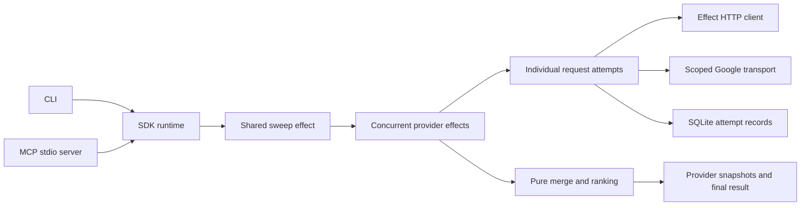

# Wideband architecture

Wideband runs one query across search providers and returns deduplicated sources with provenance, rank fusion, and request accounting. Effect 4 owns provider I/O, concurrency, cancellation, and resource lifetimes. Pure functions own URL canonicalization, merging, ranking, freshness classification, and cost arithmetic.

The [migration report](effect-4-plan.md) records the motivating defects. This document describes the implemented 0.4 architecture.

## Domain vocabulary

- A **provider** is an external search service. Its adapter translates queries and validates responses.
- A **sweep** is one shared query execution. Its `sweepId` identifies the execution even when several callers share it.
- A **request** is one logical provider operation, such as page 2 of an AnyAPI search.
- An **attempt** is one dispatch of that request. A retry creates another attempt and budget reservation.
- A **hit** is one normalized provider result. A **source** merges hits with the same canonical URL and retains their provenance.
- A **charge** is observed, estimated, or unknown. Unknown charges retain the reserved estimate.
- The **ledger** stores sweeps, provider outcomes, attempts, cached results, and session claims.

## Runtime ownership

`src/index.ts` creates one lazy `ManagedRuntime` per `wideband()` client. A scoped layer acquires the internal Ledger, creates the Engine, and supplies the Effect HTTP client. Closing interrupts active work, awaits finalizers, and closes SQLite. Subsequent calls fail with `CLOSED`.

The SDK exposes Promise methods and an asynchronous event iterator. Core operations return Effects. The standalone Google module exports Effects and Promise convenience functions. Only those convenience boundaries start a runtime.

## Files and responsibilities

- `src/core/types.ts` defines Effect Schemas, adapter contracts, request receipts, charges, and events.
- `src/core/errors.ts` defines `AdapterError`, `LedgerError`, `WidebandError`, and safe error messages.
- `src/core/engine.ts` owns provider selection, deadlines, request policy, shared execution, result assembly, and per-caller session projection.
- `src/core/ledger.ts` owns synchronous Bun SQLite operations and schema migration. The engine maps failures into typed storage errors.
- `src/core/merge.ts`, `freshness.ts`, and `cost.ts` contain pure domain operations.
- `src/adapters/http.ts` reads responses, extracts reported cost independently, and validates the response schema.
- `src/adapters/*.ts` define provider capabilities, estimates, request parameters, and normalization.
- `src/google-search.mjs` owns Google HTML parsing, the proxy inventory, the slot store, the try history, and the subprocess transport.
- `src/browser/` owns the Chrome pool: `client.ts` asks the daemon, `daemon.ts` runs the sessions, `relay.ts` forwards their proxy traffic, and `serp.ts` parses their pages.
- `src/adapters/maps.ts` owns the Maps place model, its field-path table, the request template, and paging.
- `src/cli/main.ts` and `src/mcp/main.ts` adapt the SDK to their wire protocols.

## Provider outcomes and request policy

An adapter's `search(query, context)` returns an Effect and submits each request through `context.request`. After a page succeeds, `context.addHits` contributes its hits. A later failure cannot erase them.

`RequestReceipt` pairs a typed result with an optional reported amount. A valid charge survives an invalid result envelope. Required URLs, result envelopes, and numeric fields are validated. Optional descriptive metadata may be absent or null. Raw row fields are retained for `capture`.

The engine handles recoverable `AdapterError` values independently for each provider. Defects, caller interruption, and storage failures remain distinct. An `ok` provider may return zero hits. A `partial` provider retains useful hits after a later failure, producing `complete: false`. If no provider completed successfully and no partial provider retained useful hits, the SDK rejects with the collected result attached. The CLI preserves result output and exit code 5.

`timeoutMs` is a provider deadline, including queue waits, pages, retry delays, and active transport. The caller's signal cancels its operation. Cancelling one subscriber preserves work needed by other subscribers.

A semaphore permits one active request per provider within an Engine. Genuine rate limits update shared pacing from `Retry-After`. Quota and authentication errors neither retry nor update rate-limit pacing.

Rate-limit and transient server responses may retry once. A lost response leaves uncertain billing and does not automatically repeat potentially charged work. Google keeps its bounded tries within a zero-search-fee page and disables an additional engine retry.

## Budget and persistence

Before dispatch, the engine checks a shared sweep budget in integer microdollars and inserts a pending attempt. A failed insert prevents network work. Protected finalization records observed or estimated usage, or retains the reservation as unknown after interruption or transport loss.

Reported amounts replace reservations. Estimates account for actual page dispatches, result surcharges, research depth, and AnyAPI's automatic-fallback bound. This limits modeled exposure. It cannot undo charges or guarantee that a provider never bills above its published or modeled price.

`cost.totalUSD` includes observed amounts, ordinary estimates, and estimates for unresolved attempts. Provider costs also expose `observedUSD`, `estimatedUSD`, `unknownAttempts`, and `attempts`. A failed summary cannot erase prior attempt records. Failed attempt finalization exposes the last known charge through `LedgerError`, while the durable pending row remains uncertain.

Tables are `sweeps`, `calls`, `attempts`, `cache`, and `seen`. Migration preserves existing data. `accounting_version` distinguishes historical provider summaries from attempt records. Historical monthly `attempts` remain approximate because old rows did not retain retries and pages. Provider statistics retain `calls` as settled provider operations.

## Shared execution and sessions

Effect Cache shares in-flight sweeps with zero retention after settlement. It does not evict pending entries, so a burst cannot start a duplicate execution for an active query. SQLite retains complete successful results, including valid empty searches. Partial, failed, cancelled, and budget-truncated results do not enter the success cache.

The execution key includes normalized query, provider set, credential hashes, capture mode, budget, effective deadlines, TTL option, and sweep kind. Raw credentials never enter the key. `fresh` bypasses persistent lookup and shared execution.

Each execution retains provider completion events for late subscribers. Events contain cumulative source snapshots. Each caller receives copies, so consumer mutation cannot corrupt shared results.

Sessions are excluded from retrieval identity. A stream filters against its caller's previously seen sources. Final delivery claims source IDs atomically in SQLite. Concurrent callers in one session cannot both claim a source, while different sessions can share retrieval.

## Schemas and entrypoints

Effect Schemas define query, source, sweep, and tool contracts. Wire schemas use finite bounds, `optionalKey`, and `withDecodingDefaultKey`. Parse helpers treat explicit undefined object properties as omissions for SDK callers. Null and invalid array elements remain invalid.

The CLI adds `--stream` NDJSON without changing the meanings of result limits, pagination, freshness, or provider deadlines. Normal output remains JSON or pretty text, with diagnostics on stderr.

The custom MCP boundary generates shared tool schemas, negotiates protocols, handles cancellation, and awaits accepted work after EOF. SIGTERM cancels requests and waits for cleanup. The bundled Effect MCP implementation was evaluated; retaining the small boundary avoided additional capabilities and protocol coupling.

## Google providers

Wideband has two Google providers, and the caller chooses one. Nothing falls back from one to the other. `src/adapters/google.ts` builds both from one factory over a page function, so they share capabilities, error mapping, and the paging loop.

- `google` fetches pages over HTTP through `searchEffect` in `src/google-search.mjs`. Default scans include it.
- `google-browser` asks the Chrome pool through `browserPage` in `src/browser/client.ts`. Its adapter sets `optIn`, so the engine leaves it out of the default provider list. Only an explicit `--providers google-browser` runs it.

Measurements from October 12, 2026 decided the split. Over 100 pages, the rotating HTTP route returned 89 in 138 tries; 75% passed on the first try, and a blocked try cost 2.7 KB. The browser route returned 46 of the same 100 queries: 37 of 39 Chrome sessions got a captcha on their first query, and the median page took 25 seconds. An automatic fallback held a failed page for 30 to 60 seconds in a pool that usually answered with a captcha.

## Google HTTP route and slots

The HTTP route uses `uv` and pinned `curl_cffi` in a detached process group. Its Effect callback finalizer kills the group and waits for close. The standalone module runs on Node 22.16 or newer without Bun-specific imports and keeps its state with `node:sqlite`.

Webshare usernames control rotation. `USERNAME-rotate` gives each connection a new exit IP, and `USERNAME-<N>` keeps one exit IP for session number N. A fixed-IP probe on October 12, 2026 sent queries 12 seconds apart with one cookie jar per IP. Three of four IPs served 30 of 30 searches with no block, and kept-alive pages took 0.6 seconds. The fourth IP was blocked on its first query. Slots keep that pattern.

A slot is a session number from 50,000 to 99,999 that pins one exit IP, plus the identity Google has seen from it: a User-Agent family and agent, fixed for the slot's life, and the cookies Google set on that IP. The browser pool uses 10,000 to 49,999, so the two routes never share a session. The `slots` table in `~/.wideband/google-tries.sqlite` holds one row per warm slot, which is a slot that passed a query and has not been blocked since. The table has no state column. A blocked, failed, or idle slot is deleted, and a fresh slot enters the table only when a page keeps it.

Each try runs these steps:

1. Delete slots unused for 30 minutes. In one atomic `UPDATE ... RETURNING`, lease the slot with the earliest `next_at` among slots whose lease has expired and whose pace has passed. A lease lasts 30 seconds, one 20-second transport timeout plus process start, so a crashed process frees its slot. If no slot is ready, make a fresh one: an unused number, a random agent from `src/google-agents.json`, and no cookies.
2. Fetch through `stickyProxy(proxies[slot % proxies.length], slot)`. It rewrites `-rotate` to `-<slot>` in the username and keeps the rest of the proxy string, port included. A line without `-rotate` stays unchanged. The request sends the family's header set in order, the slot's User-Agent, and its cookies over HTTP/1.1. The transport returns the cookies the response set.
3. On an ok page, keep the slot: merge the cookies, set the next query at least 12 seconds later, clear the lease, and count the query. On unrecognized markup, keep the slot the same way and fail the page at once, because the page is the parser's problem, not the IP's. On a block, a transport failure, a non-200 response, or Google's unsupported-browser page, delete the slot and try again.

A page makes at most five tries within a 75-second deadline. A slot that is still pacing is not leased, so the pages of one search usually use different slots, and concurrent searches grow the warm set. If the slot store fails, the try uses a fresh slot; slot writes are best-effort and never fail a search.

The `tries` table records the time, route (`http` for this transport, `maps` and `browser` for the others), query, attempt number, outcome, exit IP (decoded from Google's `/sorry` redirect, so blocked tries only), curl-counted bytes, proxy `host:port`, User-Agent family and agent, and slot of every try. Each write deletes rows older than seven days. History writes are best-effort and never fail a search. A failed page records `google:<reason>` as the attempt's ledger error code, where the reason is the SearchError code or the ordered list of failed tries.

## Google browser pool

The pool is a daemon, because each search is a short-lived CLI process and a warm session must outlive it. The bound port `127.0.0.1:47651` is the single-instance lock: a second daemon exits, and nothing stale survives a crash. `src/browser/client.ts` owns the client half. A CLI that finds no daemon starts `wideband browser` detached, with output appended to `~/.wideband/browser.log`, and polls for 3 seconds. The daemon accepts only `POST /search` with a JSON content type and the exact `Host` header; `GET /status` lists sessions.

`src/browser/daemon.ts` owns the sessions. Each session is its own Chrome, launched through its own relay (`src/browser/relay.ts`). The relay forwards CONNECT to the proxy that `stickyProxy` gives the session's slot, so the session keeps one exit IP across connections. It refuses every host but the five Google search hosts, so Chrome's own traffic never reaches the proxy, and it counts the bytes. A session opens with a desktop Chrome User-Agent, which passes Google's first query more often. After its first pass, the session switches to a Firefox-for-Android User-Agent and a 412x915 viewport, and Google serves its lightweight layout: about 45 KB a page with plain `/url?q=` links. `src/browser/serp.ts` parses that layout; a light page with no result blocks is an empty result, not an unknown page.

Session states are `starting`, `warm`, `blocked`, and `retired`, and a transition table maps each query verdict to the next state. A captcha, an HTTP 403, a JavaScript wall, or a navigation timeout blocks a session. A crash, an unrecognized page before the session has passed once, or two misses in a row (tunnel failures or unrecognized pages) retire it. A blocked or retired session closes its Chrome. A request takes the free session with the earliest next turn, and each session waits 12 seconds between queries. The pool opens a session only when no session is warm or a request has already waited 12 seconds, opens one at a time at least 5 seconds apart, and holds at most two. Before each open, `browserFailures` counts the failed browser tries of the last hour in the `tries` table; at 40, the pool opens nothing more and answers `capped`. That bounds a bad hour to about 3.5 MB of blocked first pages. Requests carry a 30-second queue deadline, and no open or query starts after it. Every query writes a `tries` row with route `browser`, family `desktop` or `mobile`, the session's slot, and the relay's byte count. The last page the parser did not recognize is saved per layout to `~/.wideband/browser-unrecognized-desktop.html` or `-mobile.html`.

## Maps request template

Maps answers `/search?tbm=map` with a JSON array behind a `)]}'` prefix. The `pb` parameter is a template that tells Google which sections to fill. Wideband sends `!1s<query>!7i20`, then `!8i<offset>` for later pages, then the template tail; Google ignores the URL `start` parameter. The default tail ships in `src/maps-pb.json`, and a refreshed tail lives in `~/.wideband/maps-pb.txt`. A list answer carries places at `data[64][i][1]`. A single match carries one at `data[0][1][0][14]`. A no-results answer carries neither. Template drift is a missing prefix, unparseable JSON, a list answer (`data[0][1][0][10]` present) without `data[64]`, or list entries that never decode as places. A broken template otherwise looks like an empty result. Drift triggers one refresh from the `/search?tbm=map` link on the `/maps/search/<query>` page, then one retry. Blocks and transport failures retry at once, up to three tries per page. Every try, the refresh included, records a `tries` row with route `maps`.

## Verification

`bun run test` exercises SDK and CLI searches against local HTTP, checks actual SQLite records, and drives MCP over stdio. It covers normalization, partial results, budgets, retries, schemas, caching, sessions, streaming, cancellation, storage failures, and shutdown without paid provider calls.

`bun run typecheck` checks source and in-repo consumers. `bun run build` produces package entrypoints and declarations. `testing/google-live.ts` uses configured Google proxies and providers. Live quota or authorization failures do not establish successful provider normalization.
